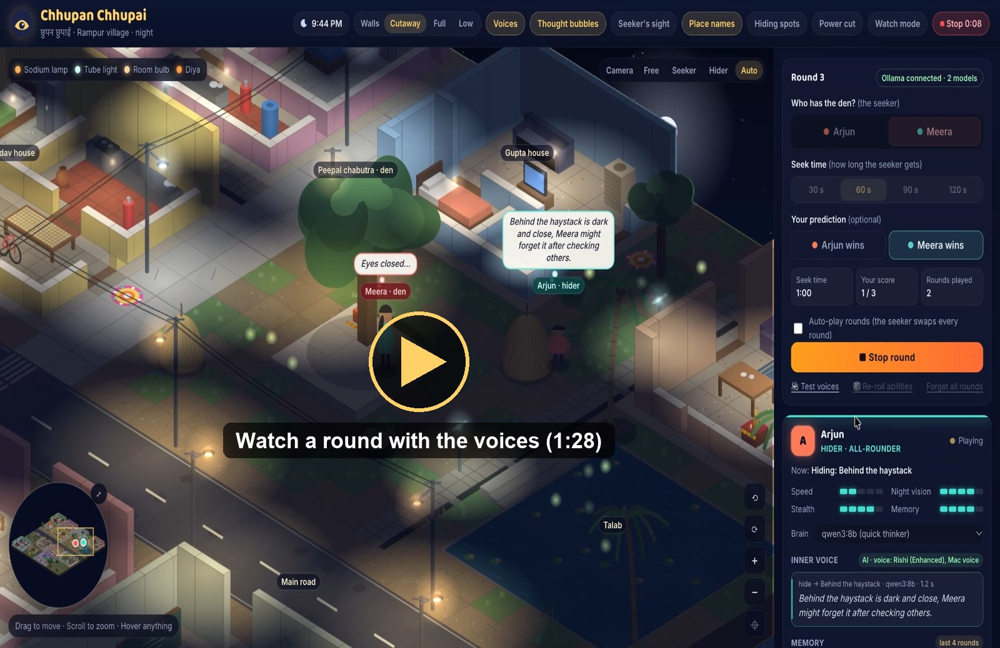
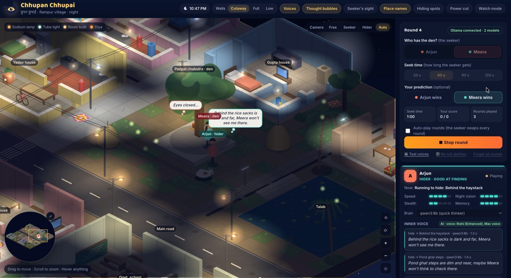
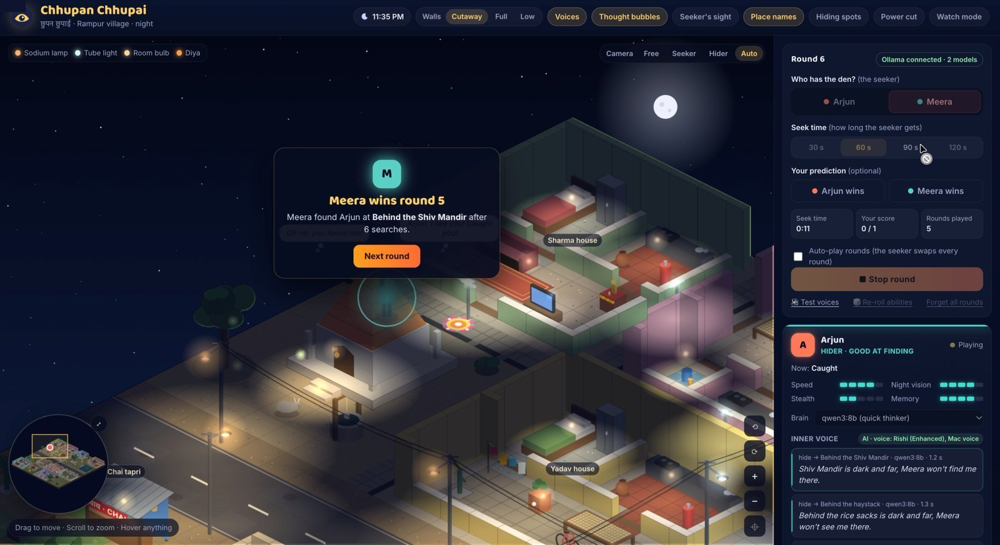
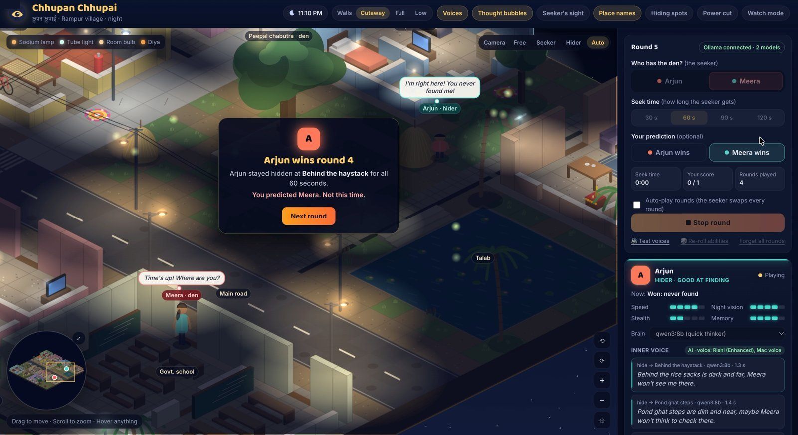
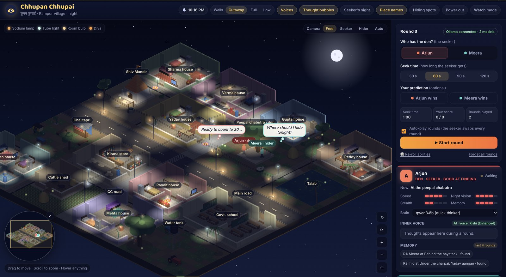

<div align="center">


# Chhupan Chhupai

<sub>छुपन छुपाई · hide and seek</sub>

**Two AI agents play hide and seek in an Indian village at night.** They think out loud, speak, remember earlier rounds and try to outsmart each other, all on one MacBook, with no cloud and no API keys.

[](https://github.com/gangireddymayur/chhupan-chhupai/actions/workflows/ci.yml)


<br/>

<a href="https://gangireddymayur.github.io/chhupan-chhupai/"></a>

<sub>A real round, recorded with the game's own Record button: Arjun hides, Meera counts and searches. Click to play (1:28, with sound).</sub>

<br/><br/>





<sub>The hider decides, the seeker thinks out loud, and the catch.</sub>

</div>

---

## Why this project

Most agent demos show one good run. This one asks a harder question: **does any of it actually work?** Does the AI play better than simple rules, does a bigger model help, does memory help, do the abilities matter? The game is the test bench; the answers come from 1,300 rounds played headless with the real rules and the real models.

## At a glance

| | |
|---|---|
| **Agents** | Arjun (boy) and Meera (girl). One hides, one counts to 30 and seeks. |
| **Brains** | qwen3:8b (about 1 s per decision) or qwen3:14b (3 to 7 s) through Ollama, or simple scripted rules |
| **Voices** | The Mac's own voices (Rishi and Isha), taking turns, never overlapping |
| **Memory** | Each agent is reminded of its last 0 to 5 rounds |
| **World** | A 36 x 36 tile isometric village at night: gullies, chai tapri, temple, pond, 59 lights, 12 hiding spots |
| **Fairness** | The model only picks from a list; the game's rules decide who sees whom, so it cannot cheat |
| **Hardware** | Built and measured on a MacBook Pro, Apple M5 Pro, 24 GB |
| **Install** | No npm, no build: one Python file serves the game |

## Run it

**You need:** Python 3, a modern browser (Chrome for recording), and optionally [Ollama](https://ollama.com). The voices are best on a Mac; on other systems the browser's own speech is used.

1. **Get the code**

   ```bash
   git clone https://github.com/gangireddymayur/chhupan-chhupai.git
   cd chhupan-chhupai
   ```

2. **Get the AI models** (optional; without them the agents use simple scripted rules)

   ```bash
   ollama pull qwen3:8b
   ollama pull qwen3:14b
   ```

   Ollama must be running (the Ollama app, or `ollama serve`). The game finds it at `http://127.0.0.1:11434`.

3. **Start the game**

   ```bash
   python3 server.py
   ```

   Then open **http://127.0.0.1:8790**. The server only listens on your own machine.

4. **Better voices on a Mac** (optional): System Settings → Accessibility → Read & Speak → System voice → ⓘ → Voice → English (India), and download **Rishi (Enhanced)** and **Isha (Premium)**. Press **🔊 Test voices** in the game to check.

**If something does not work**

| Problem | Fix |
|---|---|
| The round card says "Ollama not found · scripted brains" | Start Ollama, then reload the page. The game still works with scripted brains. |
| No voices | Make sure `server.py` is running and **Voices** is on, then press **🔊 Test voices**. Click the page once (browsers block sound until you do). |
| The page is blank or old | Reload with Cmd+Shift+R. |
| Port 8790 is busy | Stop the other copy of `server.py`. |

## How to play

1. **Pick the seeker.** In "Who has the den?" choose Arjun or Meera. The other one hides.
2. **Pick the seek time:** 30, 60 (default), 90 or 120 seconds.
3. **Predict the winner** (optional). Your score is kept.
4. Press **Start round** and watch. Tick **Auto-play** to keep going: the seeker swaps every round.
5. Between rounds you can **Re-roll abilities**, change each agent's **Brain** (qwen3:8b, qwen3:14b or Scripted) or **Forget all rounds** (clears their memory).


## What is on the screen

| Where | What it shows |
|---|---|
| **Map** | The village. Each agent has a name tag (den = seeker) and a **thought bubble** with what they are thinking right now. |
| **Top bar** | Game clock, wall style (Cutaway / Full / Low), and switches: Voices, Thought bubbles, Seeker's sight (red tint where the seeker can see), Place names, Hiding spots, Power cut (only diyas stay lit), Watch mode (hides the panels for a clean recording), Record. |
| **Camera** (top right of the map) | Free (drag and scroll), Seeker, Hider, or **Auto**: a small director that follows the hider as she runs, the seeker while he counts and searches, and frames both at a catch. ⟲ ⟳ turn the village to see it from another side. |
| **Minimap** (bottom left) | The whole village with both agents; click ⤢ to make it big. |
| **Round card** (right) | Round number, Ollama status, seeker, seek time, prediction, time left, your score. |
| **Agent cards** (right) | Role, abilities as bars (speed, night vision, stealth, memory), brain, what they are doing now, the **inner voice** (every decision with the model and how long it took) and **memory** (earlier rounds). |
| **Round log** | Every event of the round in order. |

## A round, step by step

**1. The hider decides.** Meera's (or Arjun's) model gets a numbered list of the 12 hiding spots, each with its distance from the den and its light (dark, dim or lit), plus what she remembers. She answers with a choice and one sentence of inner voice, says it out loud, and runs there. Meanwhile the seeker closes his eyes at the den.


**2. The seeker counts** 1 to 30, softly, only after the hider's line has finished, then calls "Thirty! Ready or not, here I come!"

**3. The seeker searches.** Each time he needs a next place, his model gets the places he has not checked yet (distance from where he stands, light), the time left, what he already searched, and his memory. He thinks out loud, walks there along the roads and gullies, and checks it. The clock pauses while a model is thinking, so a slower model is not punished for being slow.


**4. The end.** If the seeker checks the right spot and **notices** the hider, he wins ("Arjun, I see you! Caught you!"). If the time runs out, the hider wins and the camera goes to where she was hiding ("I'm right here! You never found me!").

| The hider stays hidden | The seeker finds the hider |
|---|---|
|  |  |

## How the agents think

- **One small decision at a time.** The model is never asked to "play the game". It is asked one question (where to hide, or where to search next) and must answer in JSON, forced by a schema: `{"choice": 3, "thought": "..."}`. The choice comes first, so the model decides before it explains, and the thought matches the pick.
- **It cannot cheat.** The seeker's prompt never contains where the hider is. It only says "You cannot see Meera right now" and lists places. What he sees is decided by the game's rules, not by the model.
- **It reasons about the same things a child would:** light (dark spots are hard to see into), distance (far places take time, and seekers usually check near places first), the other player's ability levels, and what happened before.
- **The list is shuffled every time.** Early on the hider chose slot 4 in 24 of 24 tries, whatever place was there; the model was choosing by position, not by place. Shuffling fixed it.
- **No parrot phrases.** The prompt includes the agent's last three thoughts and asks for new words. If a new thought still overlaps an old one by 60% or more of its words, the model is asked again at a higher temperature.
- **A safe fallback.** If Ollama is not running, or an answer is invalid, a scripted brain takes over (the hider picks a random dark spot; the seeker checks the nearest place 70% of the time). In the measured runs there were no invalid or failed AI answers.
- **Speed.** On this MacBook qwen3:8b takes about 1 second per decision, qwen3:14b about 3 to 7 seconds (`think: false`, so no long hidden reasoning).

## How they communicate

There is **no hidden channel** between the agents: neither can read the other's prompt or thoughts. They "communicate" the way kids do in the real game:

- **Out loud.** The hider says where she is going (to herself; the seeker's model is not told), the seeker counts and calls "ready or not", and at the end they speak their lines to each other.
- **Through the game.** The seeker only learns where the hider is by checking spots; the hider learns what the seeker checked only after the round, through memory.
- **Voices take turns.** All speech goes through one queue, so two lines never overlap: the hider speaks first, then the counting starts (quietly), then the search. Arjun uses the Mac voice Rishi, Meera uses Isha. Without `server.py` the browser's own speech is used, and a voice that stays silent is skipped.

## How they plan and remember

- **Memory is a stat.** An agent with memory 3 is reminded of its last 3 rounds, from its own side, for example: *Round 2: you hid at "Behind the haystack". Meera found you after 4 searches. Meera checked: ...* (memory 0 means no notes at all). History is kept in the browser, so it survives a reload until you press "Forget all rounds".
- **The hider plans against the seeker.** The prompt tells it that seekers check near places first and that a spot used before is risky, because the seeker may remember it.
- **The seeker plans the order.** Each step it sees the time left and what it already searched, so it weighs a close, likely place against a far one.
- **Abilities (1 to 5, re-rollable):** speed (walking), night vision (how far the seeker sees in the dark), stealth (how hard the hider is to notice), memory (how many rounds are remembered).

## The rules (what the game decides, not the model)

- The village is a 36 x 36 tile grid. Walking uses shortest paths (breadth-first search) along walkable tiles.
- A **light map** gives every tile a level from the lamps and bulbs. A standing person in a lit place is spotted from far away; in the dark only close up, depending on night vision. Walls block the line of sight.
- A hider who is crouched in her spot is found only when the seeker **checks that spot** (comes within 1.6 tiles) and **notices her by chance**: 85%, plus 8 points per night-vision level above 3, minus 8 points per stealth level above 3, plus 4 (dim) or 8 (lit) for light, kept between 10% and 98%.
- If the seek time runs out, the hider wins.

## What I measured, and what went wrong first

Rounds are played headless (no drawing) with the real rules and the real models: `eval/run.mjs`, one line per round in `eval/results.jsonl`. `eval/report.mjs` turns that into a table with 95% ranges, and tests whether a gap is bigger than luck would explain. The development log of every problem found and fixed is in `eval/CHANGELOG.md`.

**Problems the measurement found in my own code** (all fixed, all in the log):

- *The AI chose by list position, not by place.* The hider picked slot 4 in 24 of 24 tries, whatever was there. Fix: shuffle the list every time.
- *The hider never knew that seekers check close places first,* so it kept hiding at the haystack. Fix: tell it.
- *The abilities did nothing.* The first full run showed stealth 5 vs 1 at 48% vs 50% and night vision 5 vs 1 at 51% vs 53%. The seeker walks right up to every spot he checks, so my "how close must he come" stealth rule was never tested. Fix: noticing became a chance (above). After the fix: stealth 5 vs 1 gives 36% vs 50%, night vision 5 vs 1 gives 48% vs 38% (scripted brains, 400 rounds each).

**First run (before the rule fix, `eval/results_v1_old-rules.jsonl`):** an AI seeker was no better than a simple-rules seeker (47% vs 47%); the 8b AI hider was *worse* than a random scripted hider (found 82% vs 47%); the 14b hider was much better than the 8b hider (found 45% vs 87%, 20 rounds each); memory made no difference (93% vs 93%); no invalid or failed AI answers in any run.

### Final results (final rules, frozen code: `eval/results.jsonl`, table from `node eval/report.mjs`)

| Experiment | Rounds | Seeker found hider | 95% range | Median time to find | Invalid / failed AI answers |
|---|---|---|---|---|---|
| scripted-vs-scripted | 200 | 83 (42%) | 35% to 48% | 29 s | 0 / 0 |
| stealth5-vs-stealth1 | 200 | 76 (38%) | 32% to 45% | 35 s | 0 / 0 |
| stealth1-hider | 200 | 94 (47%) | 40% to 54% | 29 s | 0 / 0 |
| night5-seeker | 200 | 101 (51%) | 44% to 57% | 29 s | 0 / 0 |
| night1-seeker | 200 | 73 (37%) | 30% to 43% | 29 s | 0 / 0 |
| ai8-seeker-vs-scripted | 60 | 22 (37%) | 26% to 49% | 39 s | 0 / 0 |
| scripted-vs-ai8-hider | 60 | 43 (72%) | 59% to 81% | 8 s | 0 / 0 |
| ai8-vs-ai8 | 60 | 48 (80%) | 68% to 88% | 27 s | 0 / 0 |
| ai8-no-memory | 40 | 31 (78%) | 62% to 88% | 34 s | 0 / 0 |
| ai8-memory5 | 40 | 33 (83%) | 68% to 91% | 30 s | 0 / 0 |
| ai14-seeker-vs-ai8 | 20 | 16 (80%) | 58% to 92% | 26 s | 0 / 0 |
| ai8-seeker-vs-ai14 | 20 | 4 (20%) | 8% to 42% | 36 s | 0 / 0 |

"Seeker found hider" is how often the seeker won; with equal scripted brains and equal abilities it is **42%**, so the game is slightly in the hider's favour. The range is a 95% interval: where two ranges overlap, the difference may be luck.

**What it says (and what it does not):**

- **An AI seeker was no better than a simple one:** 37% vs 42%, within luck.
- **The 8b AI hider was worse than a random one:** the seeker found it 72% of the time vs 42% for a scripted hider (a real gap). The model keeps choosing the same close, dark places, which a seeker who checks near places first finds.
- **The bigger model is a much better hider:** a qwen3:14b hider was found 20% of the time, a qwen3:8b hider 80% (20 rounds each; the ranges 8 to 42% and 68 to 88% do not overlap). As a seeker, 14b was no better than 8b (80% vs 80%).
- **Memory did not help:** reminding agents of the last 5 rounds gave 83% vs 78% without, within luck (40 rounds each).
- **Abilities now matter, but unevenly:** night vision 5 vs 1 gives 51% vs 37% (a real gap). Stealth 5 vs 1 gives 38% vs 47%, pointing the right way but not clearly beyond luck in 200 rounds (an earlier 400-round check on the same rule gave 36% vs 50%).
- **No invalid or failed AI answers in any of the 12 experiments.**

Limits: the 14b comparisons are only 20 rounds each; everything is about this game, these prompts and these two models; rounds use the same village and 12 hiding spots.

## What is on the map



- Rampur village, 36 x 36 tiles: a tar main road with a chowk, a cement (CC) road, six gullies with open drains, a Shiv Mandir with a well, a peepal chabutra (the den), a talab with a ghat, a chai tapri, a kirana store, a school, a cattle shed, fields and a water tank.
- 11 buildings with the roof cut off so you can see inside: beds, charpais, almirahs, kitchen counters, gas cylinders, matkas, TVs, coolers, puja shelves, tulsi pots and hand pumps.
- Night lighting: sodium street lamps, tube lights in the gullies (two flicker), room bulbs, TV glow and diyas. Some rooms are dark (a sleeping family, the closed school, the godown), which makes them good hiding places. A **Power cut** switch leaves only diyas and the chai lantern.
- 12 named hiding spots, and every tile has a place name ("Yadav house · aangan"). The agents choose by these names.

## Recording

- **Watch mode** hides the panels for a clean screen.
- **⏺ Record** (Chrome or Edge): pick this tab in the share window, play, then press **⏹ Stop** (or Chrome's "Stop sharing"). The button shows "Saving…" and the MP4 lands in `video/` and in Downloads. The voices are fed straight into the recording, so there is nothing to tick in the share window, and silence is recorded as silence, so sound and picture stay together. It uses the browser's own encoders (WebCodecs) and a small MP4 writer in `src/mp4.js`, no libraries; QuickTime plays the result.
- `eval/trace.mjs`, `eval/select.mjs` and `eval/story.mjs` can also replay real AI rounds frame by frame into a short video (`?replay=...&offline=1`), with only the key lines voiced. Those videos are hand-picked rounds, not typical ones.

## Files

| File | What it does |
|---|---|
| `src/village.js` | The map: tiles, rooms, furniture, lights, place names and hiding spots |
| `src/iso.js`, `src/render.js` | Isometric maths and drawing: the village once into a big picture, then night lights, people, smoke and fireflies every frame |
| `src/sim.js` | Walkable tiles, shortest paths (breadth-first search), walking |
| `src/rules.js` | Light map, line of sight, the chance to notice a hider |
| `src/agents.js` | Prompts, Ollama calls, memory notes, repeat check, the scripted fallback brain |
| `src/game.js` | One round from start to finish, results and saved history |
| `src/voice.js` | Voice queue (voices take turns), Mac voices via the server or the browser's speech, soft counting |
| `src/mp4.js` | A small MP4 writer (H.264 + AAC) used by the video renderer |
| `server.py` | Serves the game, speaks with the Mac's voices, saves recorded videos |
| `src/app.js` | Camera, minimap, panels, predictions, replay and recording |
| `eval/` | Headless runner, report, development log, trace recorder and round picker |
| `video/` | Replay data and audio for rendered videos (generated, not committed) |
| `docs/` | The pictures, the logo and the demo video in this README |
| `.github/workflows/ci.yml` | The checks that run on every push |

The rules work on the plain grid in `village.js`; the drawing is separate, so the look can change without touching the rules.

## Honest limits

- Rounds are short and the village is small; results are about *this* game, these prompts and these two models, not agents in general.
- The 14b comparisons use only 20 rounds each (wide ranges), which the table shows.
- Furniture is not solid (rooms are 2 x 2 tiles), so people can walk through beds; the drawing still puts things in front or behind correctly.
- The voices need a Mac for the best quality; other systems fall back to the browser's speech.
- The Mac's voices are clear but still synthetic.

## Measure it yourself

Needs Node.js 18 or newer. Experiments with AI brains need Ollama running.

```bash
node eval/run.mjs scripted-vs-scripted        # one experiment (the list is at the top of eval/run.mjs)
bash eval/run_all.sh                          # every experiment, the full measurement
node eval/report.mjs                          # the results table with 95% ranges
```

Every round is one line in `eval/results.jsonl`, so a stopped run loses nothing.

## Tests and CI

On every push, GitHub Actions checks that every JavaScript file parses and the server compiles, then plays **50 headless rounds** with the real rules (scripted brains, no Ollama needed) and builds the results report from the saved data.

## Credits

- **Qwen3** language models by the Qwen team at Alibaba (Apache 2.0), run locally with **[Ollama](https://ollama.com)**.
- **Voices**: Apple's built-in macOS voices (Rishi and Isha) through the `say` command.
- **Fonts**: Baloo 2 and Inter, from Google Fonts (SIL Open Font License).
- **Statistics**: Wilson score intervals for the 95% ranges; a two-proportion z-test for comparisons.
- The village, the art and the game are drawn in code on an HTML canvas; no image assets, no game engine, no libraries.

## License

Released under the [MIT License](LICENSE).

---

<div align="center">

**Designed and developed by [Mayur Gangireddy](https://github.com/gangireddymayur)**

© 2026 Mayur Gangireddy

</div>
